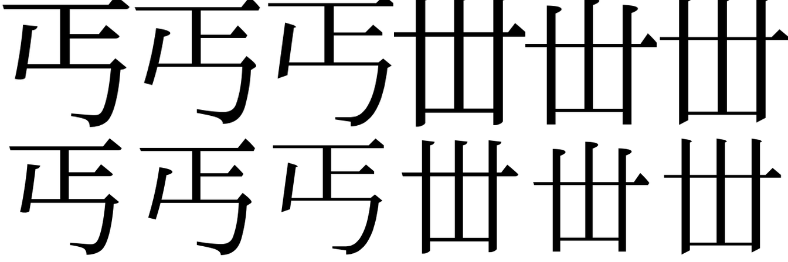

# Glyph-to-IDS benchmark

These scores measure agreement with BabelStone-derived labels, **unreviewed** outside a 181-image [reviewed sample](#reviewed-sample). Elsewhere they do not establish whether an IDS describes the glyph in the image. [The protocol](PROTOCOL.md) defines the evaluator, datasets and review procedure.

## Clean renders

The clean track contains 8,730 images of 4,752 characters in Noto Serif CJK JP, IPAmj Mincho and Jigmo. Scores below average each character's images first, then average characters. The full references, ranked predictions, per-image scores and images are in the [clean bundle](results/clean/bundle.json).

| Reader | Exact | Same-axis structure | Component family | Expanded sensitivity | Component F1 | Tree similarity |
| --- | ---: | ---: | ---: | ---: | ---: | ---: |
| han2ids font pilot | 54.92% | 54.92% | 55.13% | 55.48–73.27% | 73.88% | 80.21% |
| han2ids v0.1 | 88.19% | 88.53% | 89.45% | 90.72–94.70% | 93.98% | 95.35% |
| han2ids v0.2 | 79.30% | 79.71% | 79.90% | 83.21–90.47% | 89.01% | 91.39% |
| han2ids v0.3 | 77.95% | 78.23% | 78.37% | 81.93–89.55% | 88.12% | 90.65% |
| han2ids v0.4 | 80.05% | 80.34% | 80.51% | 82.73–90.21% | 89.18% | 91.53% |
| han2ids v0.5 | 83.77% | 84.07% | 84.24% | 85.98–91.95% | 91.31% | 93.18% |
| GlyphStudio 0.1.0 | 61.92% | 62.53% | 66.10% | 81.64–92.53% | 77.60% | 81.86% |

The expanded range applies six positional component-family rules and bounded, selective expansion using a pinned CHISE snapshot. The lower end counts unresolved comparisons as misses; the upper end counts them as matches. It is a sensitivity to these rules, not a bound on visual correctness. The source has 3,999 unparseable and 511 ambiguous definitions; 241 pairs or larger groups of distinct components have the same single-level normalized definition. The upper and lower ends differ on 562 v0.4 images and 882 GlyphStudio images. Human review is needed to determine which alternatives describe each glyph.

For v0.5 versus v0.4, the same-axis difference is **3.73 percentage points**, with a paired character-cluster bootstrap interval of **3.09 to 4.33 points**. For v0.5 versus GlyphStudio, the lower-end expanded difference is **4.34 points**, interval **3.20 to 5.46 points**; for v0.4 it was 1.09 points with an interval that included zero. These intervals describe sampling variation under the stated rules and data; they do not validate the labels.

## Reviewed sample

A seed-20261112 random sample of 100 clean-track characters, 181 images, was checked by eye. One reviewer saw each image beside its source label, without model outputs, and accepted all 181 in a single three-minute pass on 2026-11-12. No label changed, so the table restricts the clean-track scores to the sample. The [reviewed bundle](results/reviewed/bundle.json) holds the references, predictions and scores, and the [review record](results/reviewed/review/review.json) binds the [annotations](results/reviewed/review/annotations.jsonl) to the packet; the images are in the clean bundle.

| Reader | Exact | Same-axis structure | Component family | Expanded sensitivity | Component F1 | Tree similarity |
| --- | ---: | ---: | ---: | ---: | ---: | ---: |
| han2ids font pilot | 51.67% | 51.67% | 51.67% | 52.67–63.67% | 74.36% | 80.91% |
| han2ids v0.1 | 91.50% | 91.50% | 92.83% | 95.83–97.00% | 95.36% | 96.41% |
| han2ids v0.2 | 80.50% | 81.50% | 81.50% | 85.67–91.00% | 89.56% | 91.91% |
| han2ids v0.3 | 81.00% | 81.00% | 81.00% | 86.50–91.33% | 89.06% | 91.54% |
| han2ids v0.4 | 82.67% | 82.67% | 82.67% | 86.17–90.67% | 90.01% | 92.48% |
| han2ids v0.5 | 83.50% | 83.50% | 83.50% | 86.67–91.17% | 89.84% | 92.04% |
| GlyphStudio 0.1.0 | 50.00% | 51.00% | 58.67% | 80.67–91.67% | 71.78% | 76.99% |

For v0.5 versus GlyphStudio, the same-axis difference is **32.50 percentage points**, with a paired character-cluster bootstrap interval of **21.00 to 44.00 points**; the lower-end expanded difference is **6.00 points**, interval **−3.33 to 15.50 points**. For v0.5 versus v0.4 the same-axis difference is **0.83 points**, interval **−3.50 to 5.33 points**: the sample is too small to show the gain seen on the full track. The review confirms the preferred label only; it lists no alternative descriptions, so the expanded range stays a sensitivity to the rules. The accepted labels are unified readings: for U+49B3 the label is `⿵門鄉` in all three faces, while the [font variant notes](../docs/font-variants.md) give each face its printed form.

## Matched style track

The style track renders the same 673 characters in Shippori Mincho B1 ExtraBold and Noto Sans CJK JP, giving 1,346 images. Both styles inherit unreviewed source labels. They test a different, smaller character population from the clean track, so their scores are not a controlled difficulty comparison with the full track. The [style bundle](results/styles/bundle.json) contains the images and outputs.

| Reader | Exact | Same-axis structure | Component family | Expanded sensitivity | Component F1 | Tree similarity |
| --- | ---: | ---: | ---: | ---: | ---: | ---: |
| han2ids font pilot | 82.69% | 82.69% | 82.76% | 82.76–89.90% | 89.57% | 91.50% |
| han2ids v0.1 | 82.17% | 82.39% | 84.47% | 84.77–91.16% | 90.17% | 92.49% |
| han2ids v0.2 | 88.63% | 88.78% | 89.00% | 90.19–94.87% | 93.67% | 94.90% |
| han2ids v0.3 | 84.77% | 84.84% | 85.22% | 86.33–93.46% | 90.62% | 92.38% |
| han2ids v0.4 | 87.15% | 87.15% | 87.37% | 88.19–93.98% | 92.11% | 93.60% |
| han2ids v0.5 | 90.64% | 90.64% | 90.64% | 91.31–95.10% | 94.28% | 95.46% |
| GlyphStudio 0.1.0 | 70.73% | 70.73% | 80.46% | 86.63–94.50% | 82.99% | 86.56% |

## Ranked candidates

A seed-20261112 random sample contains 256 characters and 477 clean images. Each top-one and top-five value comes from the same ranked list. han2ids uses its five-beam em-box path; GlyphStudio uses its shipped IDS ensemble and candidate merging. The [candidate bundle](results/candidates/bundle.json) records the sample and predictions; its images are in the clean bundle.

| Reader | Same-axis top 1 | Same-axis top 5 | Expanded top 5 sensitivity |
| --- | ---: | ---: | ---: |
| han2ids font pilot | 56.38% | 65.10% | 65.49–87.76% |
| han2ids v0.1 | 90.36% | 97.33% | 97.98–99.09% |
| han2ids v0.2 | 80.40% | 88.28% | 93.55–97.01% |
| han2ids v0.3 | 80.73% | 87.30% | 92.77–97.33% |
| han2ids v0.4 | 81.77% | 88.02% | 90.36–97.14% |
| han2ids v0.5 | 84.11% | 91.34% | 93.10–96.61% |
| GlyphStudio 0.1.0 | 60.35% | 64.45% | 85.55–97.66% |

## Conditions and limitations

- **References:** Of the 10,076 clean and style images, 181 have labels accepted by one reviewer; the rest are unreviewed. The evaluation uses the source manifest's first usable IDS; a regional sequence and the visible font form may differ. GlyphStudio's enhanced IDS notation is not fully supported: on the clean track 47 top-one outputs are unsupported and nine malformed under this evaluator. Unsupported outputs remain in the score denominator and are reported separately.
- **Training exposure:** Noto, IPAmj and Jigmo were training families for han2ids v0.3, v0.4 and v0.5; test characters were held out in that split. v0.5 also trained on ink-fitted renders of its training characters, the framing of the clean track, and on glyphs composed from two components, none of whose unified reading is a validation or test label. The v0.3 vocabulary was assembled from all label records. The repository's [leak audit](../docs/leak.md) found 89.9% of the current test characters in v0.1 training. Font and character exposure for GlyphStudio is unknown. A new typeface or render alone does not prove held-out exposure.
- **Decoding:** Full-track han2ids results use batched greedy em-box decoding without TTA; the v0.5 runs score the unified reading, with printed forms folded into the component that stands for them; GlyphStudio uses its shipped ensemble beam and canonicalization. They are application configurations with different compute budgets. Batched han2ids confidence values are not comparable to single-image CLI scores. The font-v0.1 and v0.2 checkpoints are byte-identical; v0.4a and v0.4 are also byte-identical.
- **Partial credit:** Component F1 compares component multisets; it ignores placement. Ordered tree similarity counts insertions and deletions as one and substitutions as two, allowing deletion with child promotion. Neither value is a probability of a correct glyph. Same-axis regrouping deliberately preserves order while ignoring grouping and proportions.
- **Timing and confidence:** No speed ranking or confidence calibration is reported. The GPU was shared with another workload and the references have not been independently reviewed.

## Original crop audit

The supplied fonts and renderer reproduced all 8,730 original uint8 images byte-for-byte. The [pixel hashes](results/legacy-verification/rows.jsonl.gz) and [counts](results/legacy-verification/summary.json) are published; original images are absent, so independent comparison with the originals requires the source array. A larger-canvas re-render found foreground outside the old crop at the top in 8,713 images, at the left in 7,451 and at the right in 7,752; 8,719 lost ink on at least one side. The top row below shows original images and the bottom row their complete, ink-fitted renders. The columns use Noto Serif CJK JP, IPAmj Mincho and Jigmo, repeated for two characters. Font provenance and hashes are in the [clean bundle](results/clean/bundle.json).

The [legacy bundle](results/legacy/bundle.json) preserves the historical predictions and score inputs without the original images. Its imported prediction files predate the new inference runner; their producer and configuration cannot be independently established from those files.

## Sources

- Andrew West, [BabelStone IDS](https://www.babelstone.co.uk/CJK/IDS.TXT), 2025-06-27 edition. The file warns that descriptions and glyph forms can vary by region.
- [Unicode 17, Chapter 18](https://www.unicode.org/versions/Unicode17.0.0/core-spec/chapter-18/) and [UnicodeData.txt](https://www.unicode.org/Public/17.0.0/ucd/UnicodeData.txt): IDS operators and assigned characters. Unicode does not supply a general equivalence rule for distinct IDS strings.
- [CHISE IDS, commit c3057f8](https://github.com/chise/ids/tree/c3057f890b4d7a990628873f19274ec33b58a7aa), GPL-2.0-or-later. The 18 external source files match this revision by SHA-256; their hashes and interpretation limits are in the sensitivity summaries. A shared dictionary decomposition does not prove identical glyph form.
- [Noto CJK](https://github.com/notofonts/noto-cjk), [IPAmj Mincho](https://moji.or.jp/mojikiban/font/), [Jigmo](https://kamichikoichi.github.io/jigmo/) and [Shippori Mincho](https://github.com/fontdasu/ShipporiMincho). The bundles record exact font-file hashes and face indices; the installed Shippori file's build provenance is not independently established.
- GlyphStudio 0.1.0, supplied source-with-models archive `GlyphStudio-source-with-models-0.1.0.zip`, SHA-256 `6393d4d01db3ccc97de1465e567c05590ba11ee08929a1d62e47f434655a4b81`. Training and test exposure are not documented in the supplied package.
